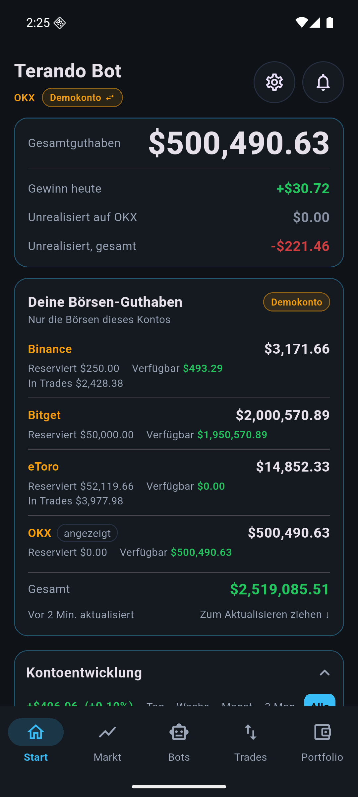
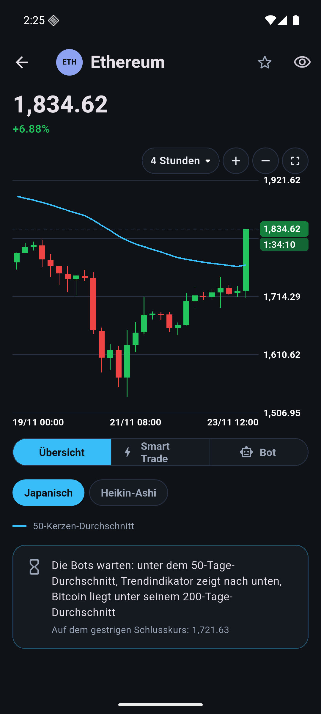
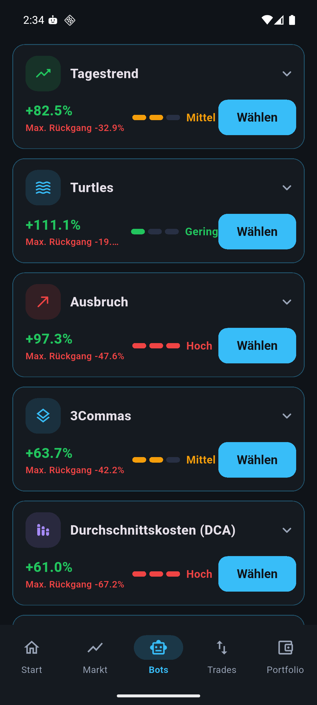
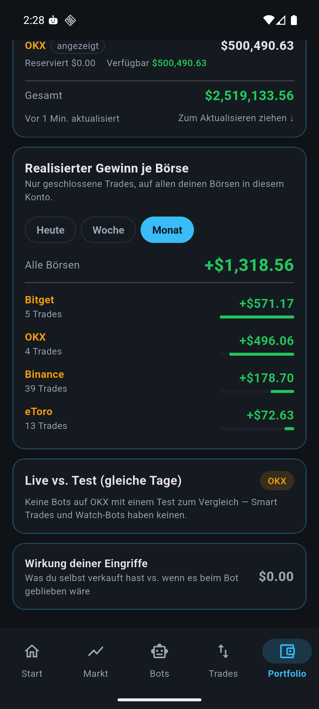
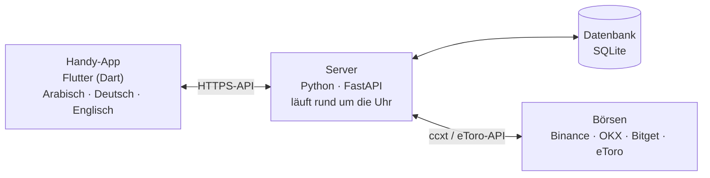

# Hallo, ich bin Amer

Ich plane und leite Apps, die echte Probleme aus meinem Alltag lösen: vom Krypto-Trading über die Verwaltung einer Geflügelfarm bis zum Verstehen deutscher Vorlesungen.

Meine Rolle: Idee, Produktentscheidungen, Planung und Tests. Der Code entsteht mit KI-Werkzeugen, und jede Änderung prüft ein zweites KI-Werkzeug, bevor sie veröffentlicht wird.

Zurzeit mache ich eine Umschulung zum Fachinformatiker für Anwendungsentwicklung bei BIB.

**Sprachen:** Arabisch (Muttersprache), Deutsch

---

## Terando – Trading-Bots mit Handy-App

Terando ist eine Plattform für Krypto-Trading-Bots. Ein Server handelt rund um die Uhr, eine Android-App steuert ihn.

> Status: persönliches Projekt für den eigenen Gebrauch – nicht kommerziell, nicht öffentlich verfügbar. Die Screenshots stammen aus einem Demo-Konto. Der Code ist privat und kann auf Anfrage gezeigt werden.

### Screenshots

| Start | Meine Bots | Trades |
| --- | --- | --- |
|  |  |  |

| Chart | Smart Trade | An der Vergangenheit testen |
| --- | --- | --- |
|  |  |  |

| Bots | Portfolio |
| --- | --- |
|  |  |

Die Prozentwerte auf der Bots-Seite sind Ergebnisse historischer Backtests, keine Gewinnzusage. Alle Beträge stammen aus einem Demo-Konto.

### Aufbau

Die App spricht nie direkt mit einer Börse. Nur der Server benutzt die API-Schlüssel.

### Funktionen

- **Bots mit verschiedenen Strategien**, zum Beispiel DCA mit Sicherheits-Orders.
- **Smart Trades:** Ziel, Stop-Loss und Sicherheits-Orders liegen als echte Limit-Orders auf der Börse.
- **Demo-Konto und echtes Konto**, klar getrennt.
- **„An der Vergangenheit testen“:** Eine Einstellung wird mit 2.000 möglichen Verläufen aus echten Kursen der letzten 180 Tage simuliert, bevor man sie startet.
- **Benachrichtigungen** bei Kauf, Verkauf und Problemen.
- **Selbst-Update:** Die App installiert neue Versionen selbst.
- **Rechts-nach-links-Oberfläche** für Arabisch, dazu Deutsch und Englisch.

### Technik

| Bereich | Technologie |
| --- | --- |
| App | Flutter (Dart), Android |
| Server | Python, FastAPI |
| Datenbank | SQLite |
| Börsen-Anbindung | ccxt |
| Betrieb | Linux-Server (Hetzner), Cloudflare Tunnel, systemd |

### Qualität

- Jede Änderung geht durch ein Code-Review, erst dann wird sie veröffentlicht.
- Neue Funktionen laufen zuerst im Demo-Konto und im Android-Emulator.
- Entscheidungen beruhen auf Tests mit historischen Daten, zum Beispiel über 5 Jahre und 13 Coins.

### In Zahlen

| | Zeilen |
| --- | --- |
| Code (Server, App, Texte, Forschung) | ca. 55.000 |
| Automatische Tests | ca. 21.500 (über 1.100 Tests) |
| Commits | über 770 |

---

## Weitere Projekte

- **Geflügelfarm-App:** Verwaltung einer Geflügelfarm (Flutter, Firebase).
- **Fahim:** transkribiert deutsche und englische Vorlesungen, übersetzt sie ins Arabische und erklärt sie.

---

**Kontakt:** [LinkedIn](https://www.linkedin.com/in/amer-alhelal-1930a5397/)
