# Hallo, ich bin Amer 👋

Ich entwickle Apps, die echte Probleme aus meinem Alltag lösen: vom Krypto-Trading über die Verwaltung einer Geflügelfarm bis zum Verstehen deutscher Vorlesungen.

> 🔎 **Ich suche einen Praktikumsplatz vom 25.01. bis 29.10.2027**, gern auch remote.

| | |
| --- | --- |
| 🎓 **Ausbildung** | Umschulung zum Fachinformatiker für Anwendungsentwicklung, BIB Augsburg (seit Februar 2026) |
| 💻 **Größtes Projekt** | Terando: rund 55.000 Zeilen Code und über 1.100 automatische Tests |
| 🗣️ **Sprachen** | Arabisch (Muttersprache), Deutsch (gute Kenntnisse), Englisch (Grundkenntnisse) |
| 📫 **Kontakt** | [LinkedIn](https://www.linkedin.com/in/amer-alhelal-1930a5397/) · alhelalamer@gmail.com |

### So arbeite ich

Ich habe die Idee, beschreibe genau, was die App können soll, und treffe die Entscheidungen. Den Code schreibe ich mit Hilfe von KI-Werkzeugen. Jede neue Funktion teste ich selbst im Demo-Konto und im Android-Emulator und melde Fehler zurück, bis alles funktioniert. Dabei habe ich viel darüber gelernt, wie eine App, ein Server und eine Datenbank zusammenarbeiten.

In der Umschulung lerne ich, selbst zu programmieren. Genau das möchte ich im Praktikum vertiefen.

### Projekte

1. [Terando – Trading-Bots mit Handy-App](#terando--trading-bots-mit-handy-app)
2. [Almadajen – App für Geflügelfarmen](#almadajen--app-für-geflügelfarmen)
3. [Weitere Projekte](#weitere-projekte)

---

## Terando – Trading-Bots mit Handy-App

Terando ist eine Plattform für Krypto-Trading-Bots. Ein Server handelt rund um die Uhr, eine Android-App steuert ihn.

**Datenfluss und Sicherheit (Diagramme):** [terando-datenfluss.md](terando-datenfluss.md)

> Status: persönliches Projekt für den eigenen Gebrauch – nicht kommerziell, nicht öffentlich verfügbar. Die Screenshots stammen aus einem Demo-Konto. Der Code ist privat.
### Screenshots

| Start | Meine Bots | Trades |
| --- | --- | --- |
|  | 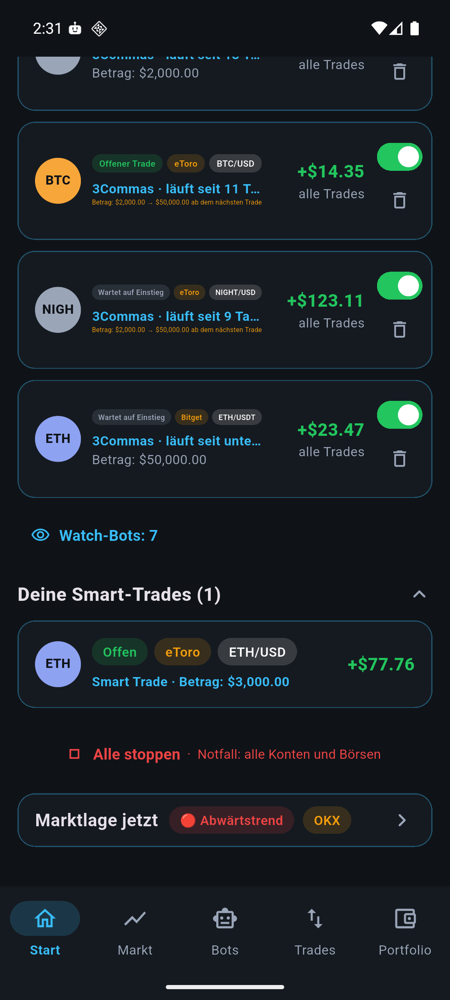 | 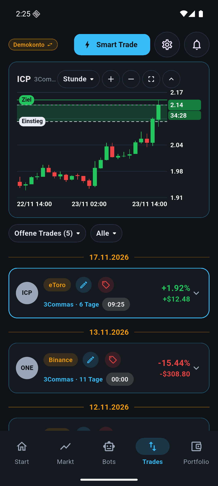 |

| Chart | Smart Trade | An der Vergangenheit testen |
| --- | --- | --- |
|  | 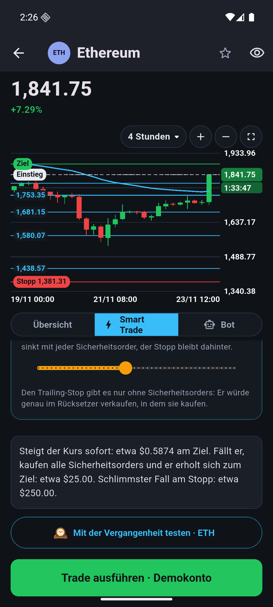 | 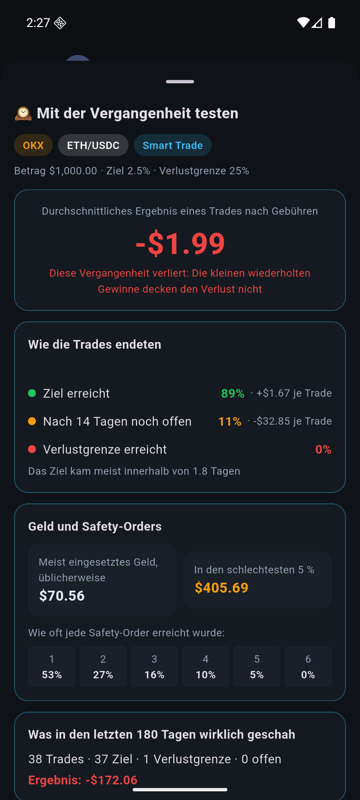 |

| Bots | Portfolio | Börse verbinden |
| --- | --- | --- |
|  |  | 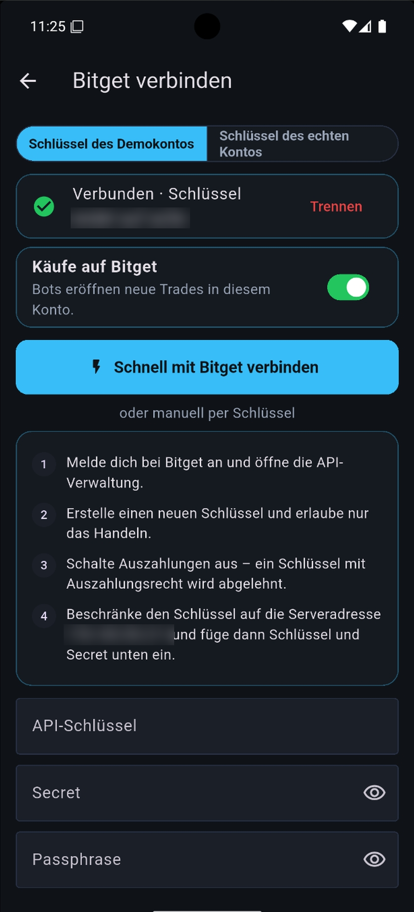 |

Die Prozentwerte auf der Bots-Seite sind Ergebnisse historischer Backtests, keine Gewinnzusage. Alle Beträge stammen aus einem Demo-Konto. Der API-Schlüssel wird verschlüsselt auf dem Server gespeichert und darf nur handeln. Ein Schlüssel mit Auszahlungsrecht wird abgelehnt. Schlüsselende und Serveradresse sind im Bild unkenntlich gemacht.

### Aufbau

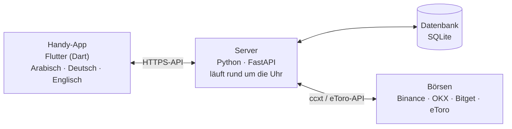

Die App spricht nie direkt mit einer Börse. Nur der Server benutzt die API-Schlüssel.

### Sicherheit der API-Schlüssel

Der Server darf mit dem Schlüssel handeln, aber nie Geld abheben. Das prüft er nicht nur einmal beim Verbinden, sondern jede Stunde.

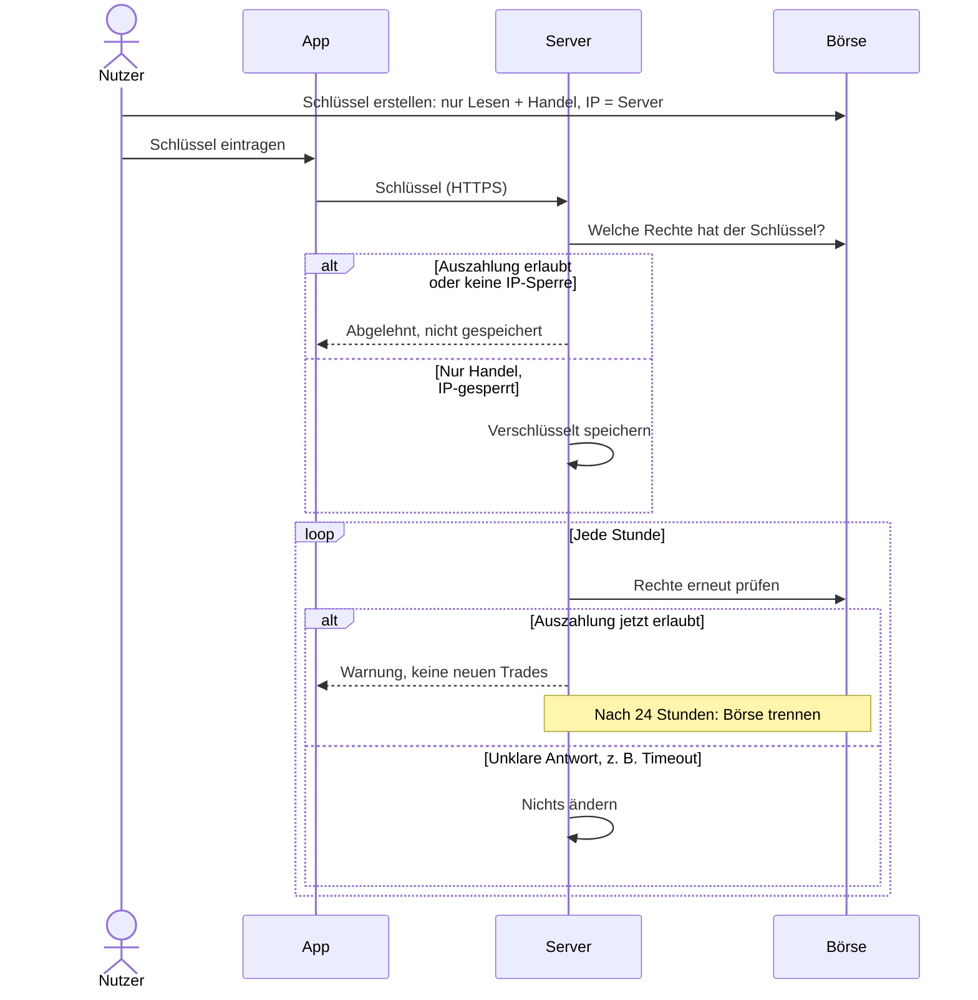

- Eine unklare Antwort der Börse löst nie eine Sperre aus. So wird kein gesundes Konto wegen eines Netzwerkfehlers getrennt.
- Bei einer Sperre behalten offene Trades ihre Sicherheits-Orders.
- Die stündliche Prüfung kam nach einem externen Review meines Datenfluss-Diagramms dazu. Vorher wurden die Rechte nur beim Verbinden geprüft.

📄 Der vollständige Datenfluss mit Anmeldung, Handel und Notfall: [drei Diagramme](terando-datenfluss.md) · [als PDF](docs/terando-datenfluss.pdf)

### Funktionen

- **Bots mit verschiedenen Strategien**, zum Beispiel DCA mit Sicherheits-Orders.
- **Smart Trades:** Ziel, Stop-Loss und Sicherheits-Orders liegen als echte Limit-Orders auf der Börse.
- **Demo-Konto und echtes Konto**, klar getrennt.
- **„An der Vergangenheit testen“:** Eine Einstellung wird mit 2.000 möglichen Verläufen aus echten Kursen der letzten 180 Tage simuliert, bevor man sie startet.
- **Benachrichtigungen** bei Kauf, Verkauf und Problemen.
- **Selbst-Update:** Die App installiert neue Versionen selbst.
- **Rechts-nach-links-Oberfläche** für Arabisch, dazu Deutsch und Englisch.

### Technik

| Bereich | Technologie |
| --- | --- |
| App | Flutter (Dart), Android |
| Server | Python, FastAPI |
| Datenbank | SQLite |
| Börsen-Anbindung | ccxt |
| Betrieb | Linux-Server (Hetzner), Cloudflare Tunnel, systemd |

### Qualität

- Jede Änderung prüft ein zweites KI-Werkzeug, erst dann wird sie veröffentlicht.
- Neue Funktionen laufen zuerst im Demo-Konto und im Android-Emulator.
- Entscheidungen beruhen auf Tests mit historischen Daten, zum Beispiel über 5 Jahre und 13 Coins.

### In Zahlen

| | Zeilen |
| --- | --- |
| Code (Server, App, Texte, Forschung) | ca. 55.000 |
| Automatische Tests | ca. 21.500 (über 1.100 Tests) |
| Commits | über 770 |

---

## Almadajen – App für Geflügelfarmen

Almadajen („die Geflügelfarm“) ist eine App für den Alltag auf Geflügelfarmen in Syrien: Masthähnchen, Legehennen und Elterntiere. Arbeiter tragen jeden Tag Verluste, Futter, Wasser, Temperatur und Gewicht ein, auch ohne Internet. Der Besitzer lebt in Deutschland und sieht alles auf dem Handy: was heute zu tun ist, Warnungen, Berichte und Gewinn.

**Im Google Play Store:** [Almadajen – Geflügelfarm-Verwaltung](https://play.google.com/store/apps/details?id=com.madajen.poultry_farm) (Arabisch und Englisch). Tägliche Eingaben, Tagesleitfaden nach Rasse (Ross, Cobb, Hy-Line), Impfplan, Eier, Finanzen, Berichte mit Diagrammen, Warnungen per Push und eine wöchentliche KI-Analyse.

**Video (1 Minute, Englisch):** [Almadajen – Poultry Farm Manager auf YouTube](https://www.youtube.com/watch?v=4MjS_dhi-q0)

**Architektur der App (Diagramme):** [almadajen-architektur.md](almadajen-architektur.md)

> Status: echte App im Einsatz. Seit November 2026 für alle bei Google Play veröffentlicht, dazu eine Web-App ([poultry-farm-prod.web.app](https://poultry-farm-prod.web.app)), auch für das iPhone. Die Screenshots (Version 0.25.19, November 2026) stammen aus der Testumgebung mit Demo-Daten. Der Code ist privat.

### Screenshots

| Ställe | Start: Smart-Assistent und Anzeigen | Warnungen mit Tipps |
| --- | --- | --- |
| 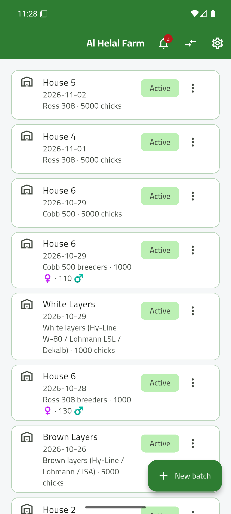 | 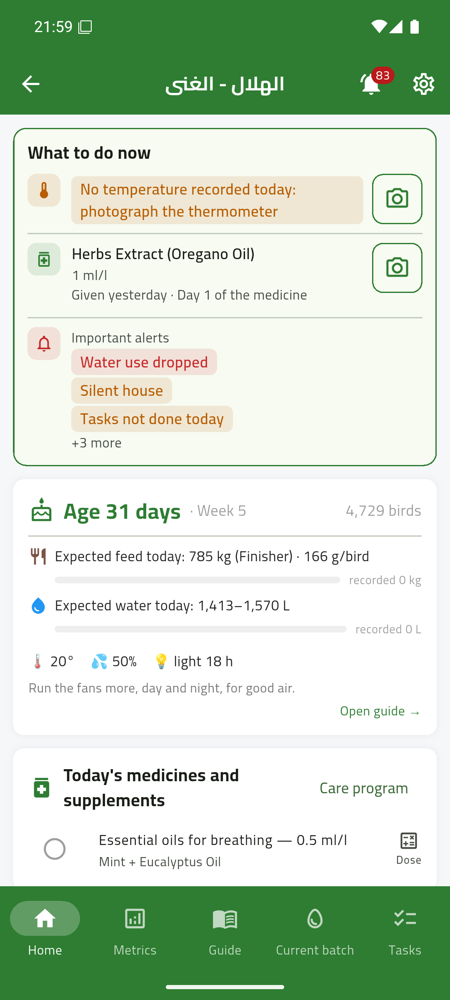 | 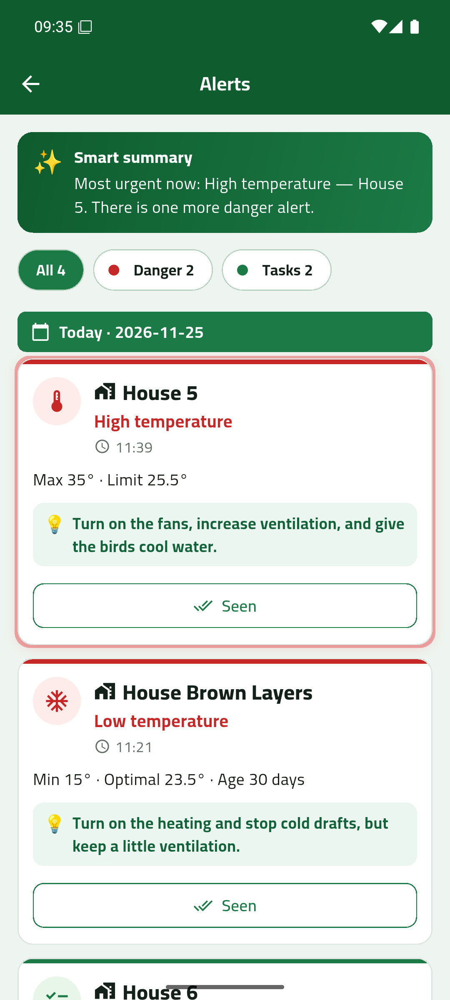 |

| Start: Kennzahlen | Tagesleitfaden | Tägliche Eingabe |
| --- | --- | --- |
| 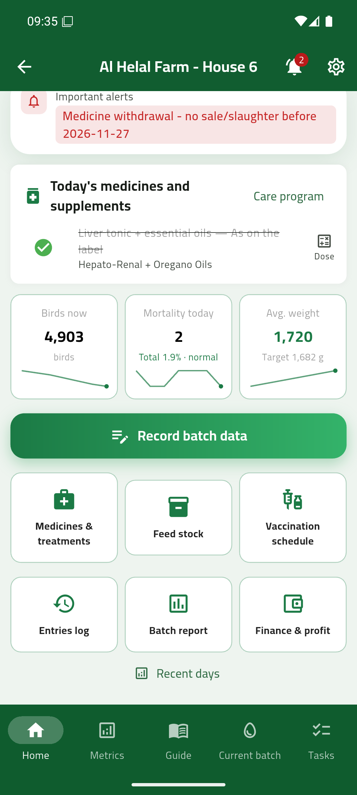 | 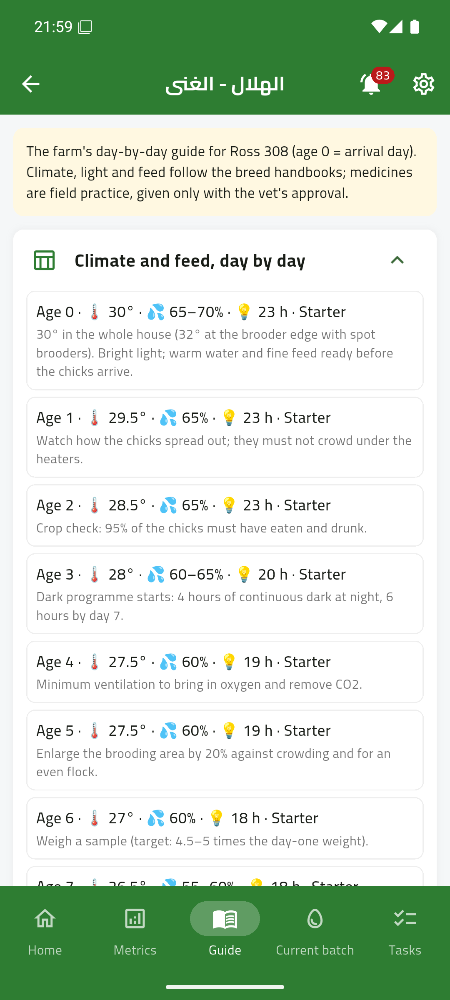 | 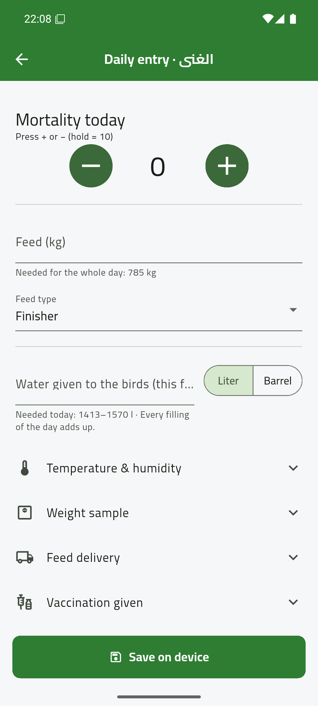 |

| Impfplan | Bericht | Diagramme |
| --- | --- | --- |
| 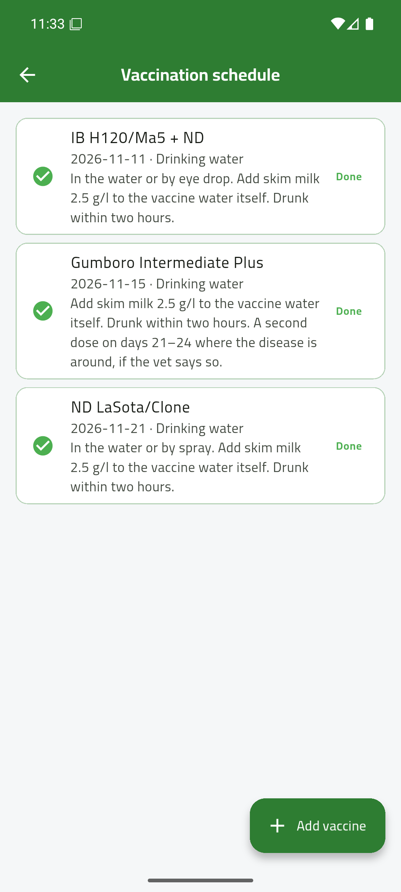 | 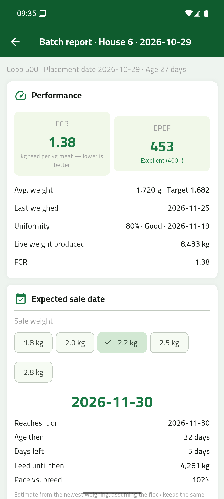 | 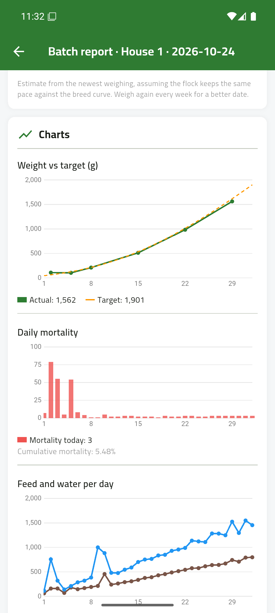 |

<b>Screenshots auf Arabisch (von rechts nach links) anzeigen</b>

 

| Ställe | Start | Warnungen |
| --- | --- | --- |
| 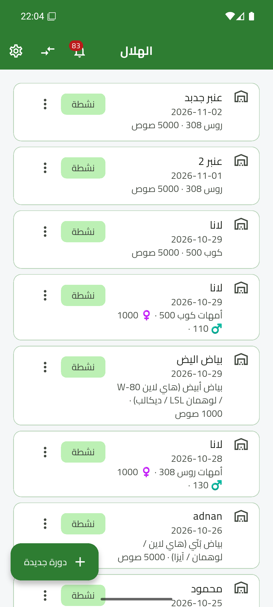 | 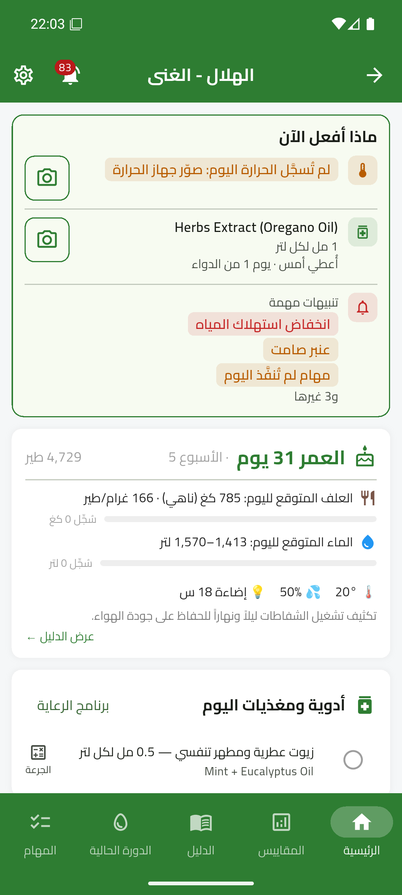 | 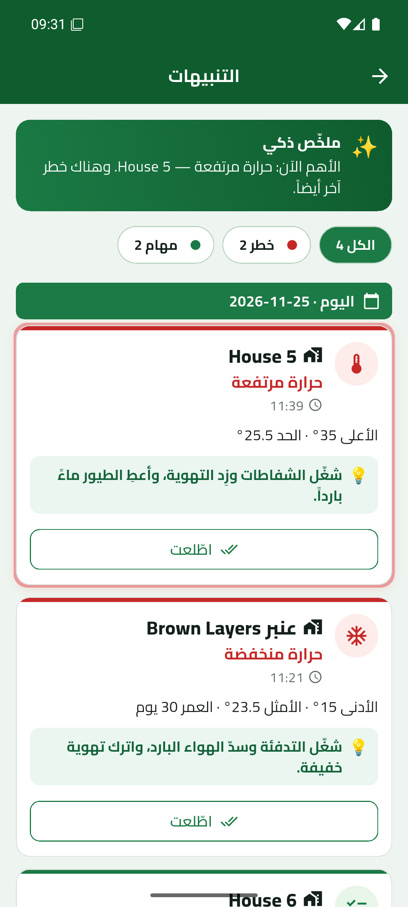 |

| Tagesleitfaden | Tägliche Eingabe | Impfplan |
| --- | --- | --- |
| 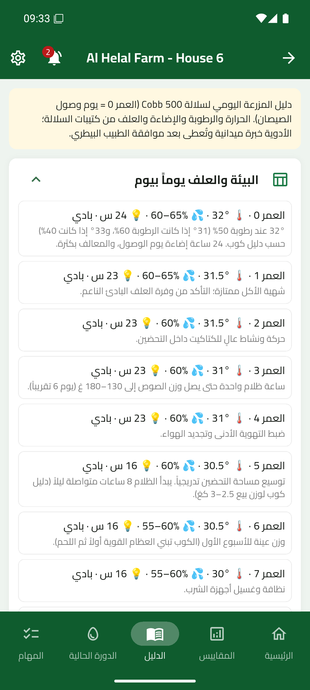 | 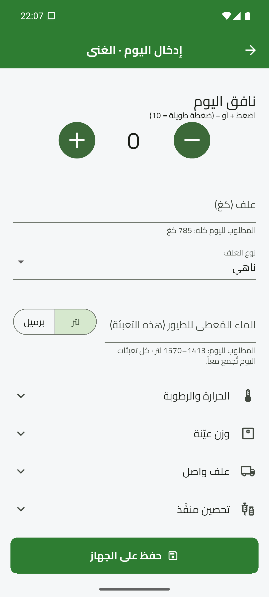 | 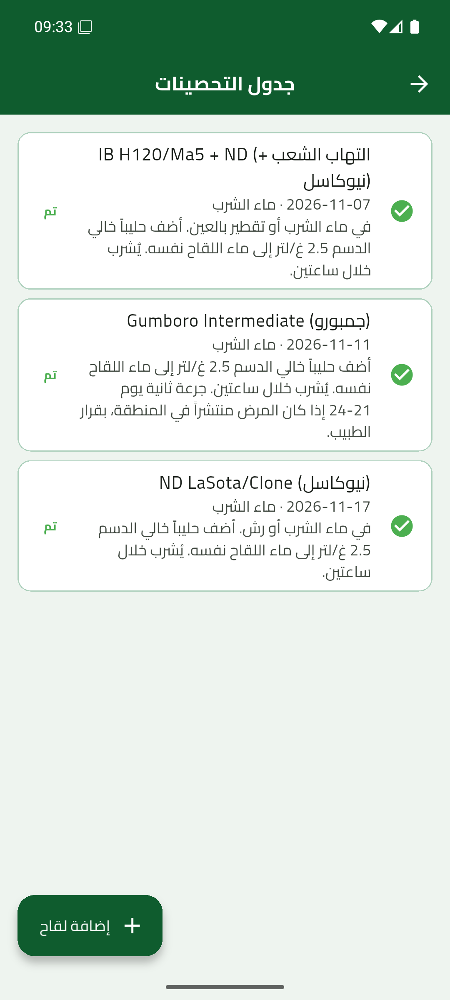 |

| Wochenanalyse (KI) | Kranke Herde (KI) | Ställe vergleichen |
| --- | --- | --- |
| 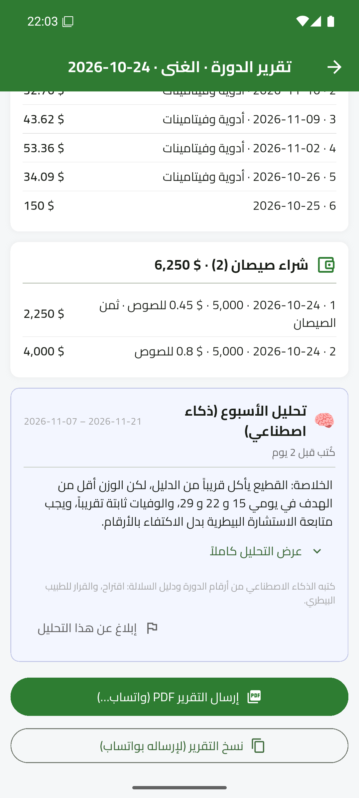 | 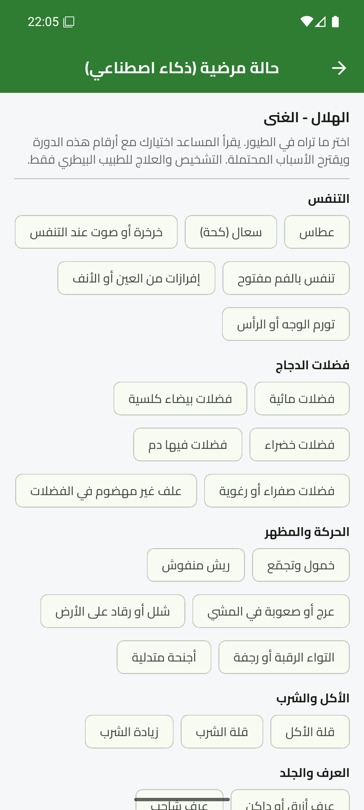 | 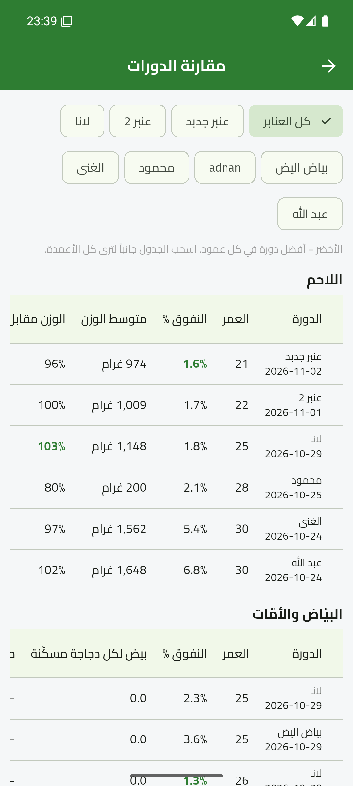 |

### Aufbau

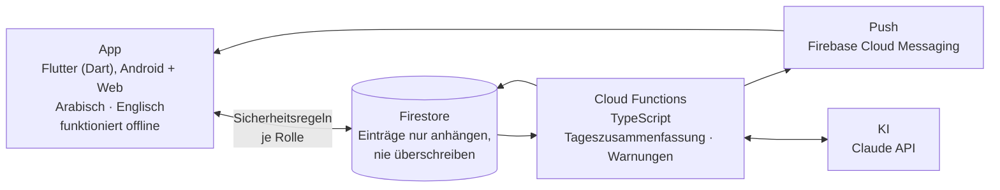

Jeder Eintrag ist ein Ereignis, das nur angehängt wird. Daraus berechnet der Server die Tageswerte, prüft sie gegen den Rassenleitfaden und schickt Warnungen aufs Handy.

### Funktionen

- **Tägliche Eingabe offline:** Verluste mit Ursache, Futter nach Sorte, Wasser in Litern oder Fässern, Temperatur, Gewicht, Eier. Ohne Netz wird gespeichert und später gesendet.
- **Tagesleitfaden nach Rasse** (Ross 308, Cobb 500, Legehennen, Elterntiere): Temperatur, Feuchte, Licht, Futtersorte und Futter- und Wassermenge für die eigene Herde.
- **„Was tun jetzt“:** Temperatur gegen Ziel („Heizung 1,2 Grad höher“), Medikamente von heute und gestern, Warnung vor falschen Mischungen, Wartezeit vor dem Verkauf.
- **Medikamentenpackung fotografieren:** Die KI liest Wirkstoff, Dosis und Wartezeit (auch mehrere Packungen auf einmal), ebenso das Thermometer.
- **Aufgaben, Medikamente und Impfungen des Tages** mit Dosisrechner. Push am Morgen, Erinnerung am Abend an Offenes.
- **Sofortige Warnungen:** Hitze oder Kälte, weniger Wasser, weniger Eier, Gewicht unter Ziel, Futter fast leer, Wetterwarnung für morgen, Stall ohne Eintrag.
- **Berichte:** FCR, EPEF, Gleichmäßigkeit, voraussichtlicher Verkaufstag, Diagramme, PDF per WhatsApp.
- **Finanzen nur für den Besitzer:** Kosten, Verkäufe, Gewinn je Durchgang, in Dollar oder Landeswährung, Kauf auf Rechnung.
- **KI:** wöchentliche Analyse der Zahlen und Hilfe bei kranker Herde. Immer als Vorschlag, die Entscheidung trifft der Tierarzt.
- **Rollen:** Besitzer, Tierarzt (nur lesen), Arbeiter (nur eigene Ställe). Einfache, eindeutige Texte für Arbeiter, die kaum lesen.
- **Zwei Sprachen:** Arabisch (von rechts nach links) und Englisch.

### Technik

| Bereich | Technologie |
| --- | --- |
| App | Flutter (Dart), Android und Web (auch iPhone über den Browser) |
| Datenbank | Cloud Firestore, offline zuerst |
| Server | Cloud Functions (TypeScript), Region Frankfurt |
| Push | Firebase Cloud Messaging |
| KI | Claude API (Anthropic) |
| Betrieb | Test- und Echtumgebung getrennt, tägliche Sicherung |

### Qualität

- Jede Änderung prüft ein zweites, unabhängiges KI-Werkzeug, erst dann wird sie veröffentlicht.
- Neue Funktionen laufen zuerst in einer eigenen Testumgebung und im Android-Emulator.
- Automatische Tests für App, Server und die Sicherheitsregeln der Datenbank.

### In Zahlen

| | |
| --- | --- |
| Code (App, Server, Regeln) | ca. 28.600 Zeilen |
| Automatische Tests | ca. 3.550 Zeilen (262 Tests) |
| Commits | über 290, seit Oktober 2026 |

---

## Weitere Projekte

- **Fahim:** transkribiert deutsche und englische Vorlesungen, übersetzt sie ins Arabische und erklärt sie.

---

## Kontakt

📫 [LinkedIn](https://www.linkedin.com/in/amer-alhelal-1930a5397/) · E-Mail: alhelalamer@gmail.com
