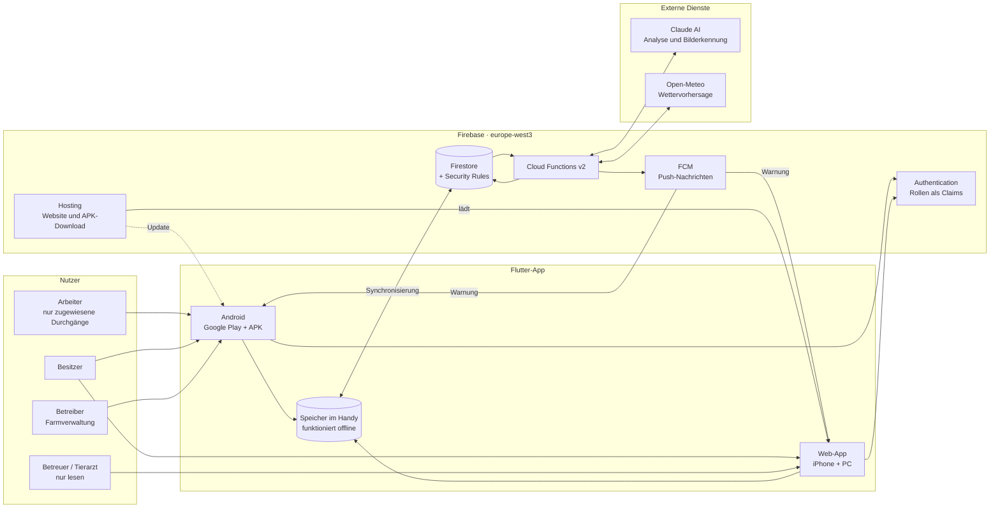
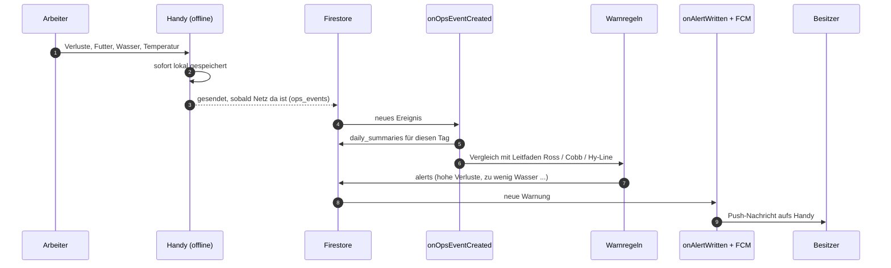
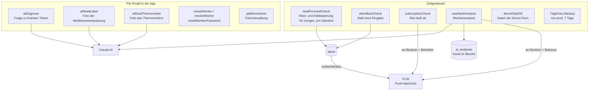
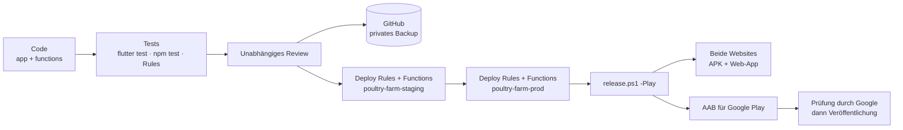

# Almadajen – Architektur der App

Wie die App für Geflügelfarmen intern arbeitet: von der Eingabe des Arbeiters im Stall in Syrien bis zur Push-Nachricht auf dem Handy des Besitzers in Deutschland. Stand 24. November 2026, Version 0.25.13.

`Flutter` · `Firestore offline-first` · `Cloud Functions v2` · `FCM` · `europe-west3` · `Claude AI`

[← zurück zum Profil](README.md#almadajen--app-für-geflügelfarmen)

## 1. Gesamtarchitektur

Eine Flutter-App läuft auf Android (Google Play oder APK von der Website) und als Web-App auf iPhone und PC. Alle Geräte schreiben in Firestore; der Server rechnet und verschickt Warnungen.

## 2. Datenfluss: von der Eingabe zur Warnung

Der Arbeiter ändert nie alte Daten; jede Eingabe ist ein neues Ereignis. Der Server fasst die Ereignisse eines Tages zusammen, vergleicht sie mit dem Rassenleitfaden für das Alter der Tiere und schickt bei Bedarf eine Warnung.

## 3. Geplante Server-Jobs und KI

Einige Funktionen laufen zu festen Zeiten, andere startet der Nutzer mit einem Knopf in der App.

## 4. Vom Code zum Nutzer

Jede Änderung wird zuerst im Testprojekt ausprobiert und dann ins echte Projekt übernommen. Rules und Functions gehen vor der App live.

## Begriffe

- **ops_events**: Jede Eingabe des Arbeiters wird als einzelnes Ereignis gespeichert. Nichts wird gelöscht; auch eine Korrektur ist ein neues Ereignis.
- **daily_summaries**: Zusammenfassung pro Tag und Durchgang: Verluste, Futter nach Sorte, Wasser, Temperatur. Der Server berechnet sie.
- **Tag 1**: Ankunftstag der Küken (Alter 0 Tage).
- **strains.ts**: Die offiziellen Rassentabellen. Daraus entsteht `assets/strains.json` für die App; Tests prüfen, dass beide gleich sind.
- **Rollen**: Der Besitzer sieht alles, der Betreuer liest nur, der Arbeiter sieht nur seine Durchgänge, der Betreiber verwaltet Farmen und Abos.
