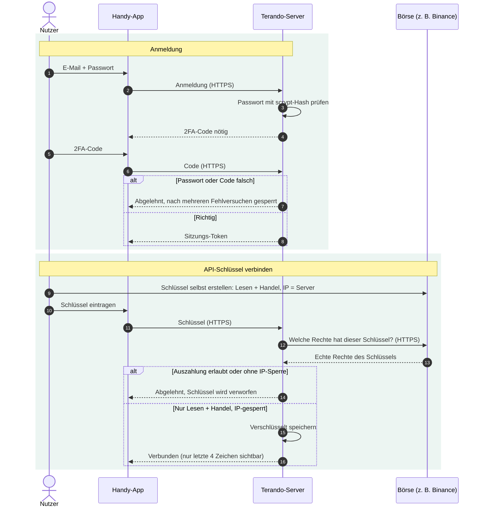
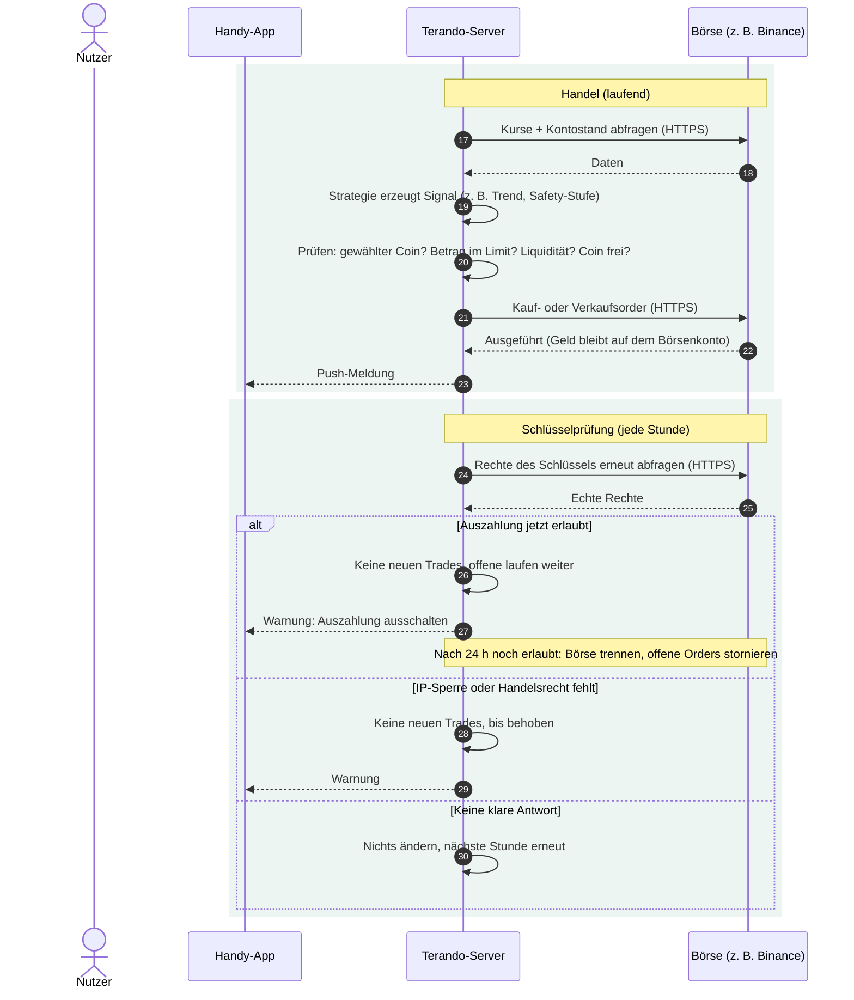
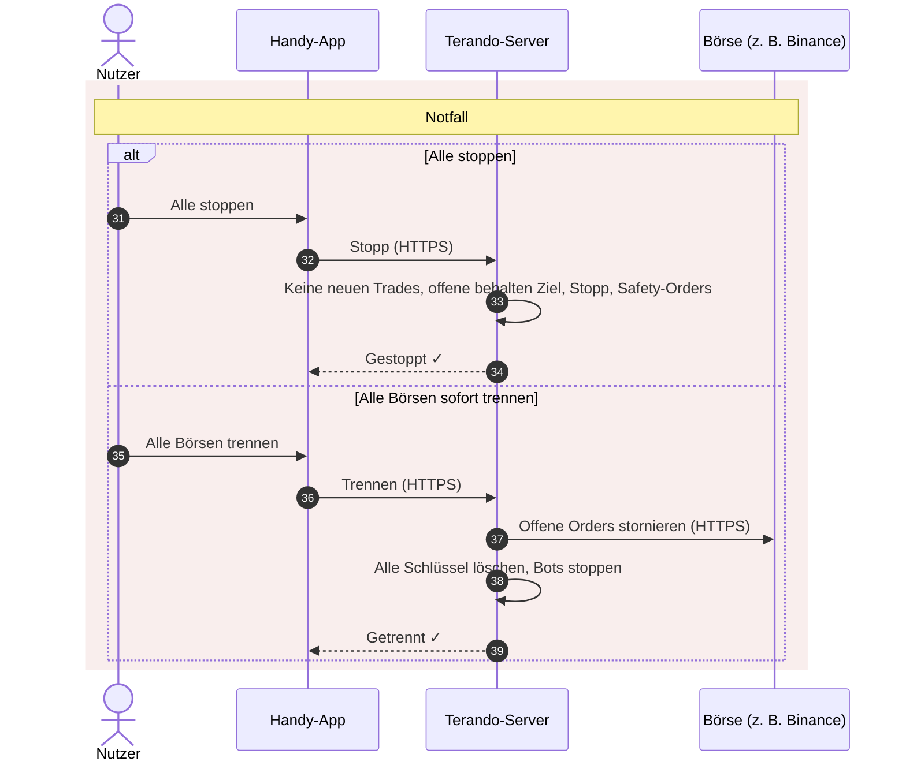

# Terando – Datenfluss und Sicherheit

Was der Terando-Server mit dem Börsenkonto macht: Anmeldung, API-Schlüssel, Handel, stündliche Schlüsselprüfung und Notfall. Stand 24. November 2026.

`Flutter` · `Python / FastAPI` · `HTTPS` · `verschlüsselte API-Schlüssel` · `IP-Beschränkung` · `Server in Nürnberg (EU)`

[← zurück zum Profil](README.md#terando--trading-bots-mit-handy-app)

Kurz: Der Server holt Daten nur über den API-Schlüssel, den der Nutzer selbst auf seiner Börse erstellt. Damit kann er handeln, aber **kein Geld abheben oder überweisen**. Einen Schlüssel mit diesem Recht lehnt er ab, beim Verbinden und danach jede Stunde.

## 1. Anmeldung und Schlüssel verbinden

Der Nutzer meldet sich mit Passwort und 2FA-Code an. Den API-Schlüssel erstellt er selbst auf der Börse. Der Server fragt die Börse nach den echten Rechten des Schlüssels und speichert ihn nur, wenn er handeln, aber nicht auszahlen kann.

## 2. Handel und stündliche Schlüsselprüfung

Vor jeder Order prüft der Server Coin, Betrag, Liquidität und ob schon ein anderer Bot einen offenen Trade in diesem Coin hat. Jede Stunde fragt er die Rechte jedes echten Schlüssels erneut ab. Er reagiert nur auf eine eindeutige Antwort der Börse: Ein Timeout ändert nichts.

## 3. Notfall

Zwei Knöpfe mit unterschiedlicher Wirkung. „Alle stoppen“ lässt offene Trades mit ihren Safety-Orders weiterlaufen, damit sie in einem fallenden Markt nicht ungeschützt sind. „Alle Börsen sofort trennen“ storniert alles und löscht die Schlüssel.

Es gibt keinen Pfeil „Geld abheben“: Der Server hat dieses Recht nicht.

## Was der Bot kann und was nicht

| Kann | Kann nicht |
| --- | --- |
| Kurse und Kontostand lesen | Geld abheben oder auf ein anderes Konto überweisen |
| Kaufen und verkaufen, nur die gewählten Coins | Mit einem Schlüssel weiterhandeln, der plötzlich Auszahlungen erlaubt |
| Pro Order höchstens den eingestellten Betrag | Den Schlüssel wieder anzeigen (sichtbar sind nur die letzten 4 Zeichen) |
| Pro Coin und Konto nur einen offenen Bot-Trade halten | |

## Was schützt

- Der Schlüssel funktioniert nur vom Terando-Server aus (IP-Beschränkung). Ein gestohlener Schlüssel ist woanders nutzlos.
- Stündliche Prüfung der Schlüsselrechte.
- Feste Coin-Liste, Höchstbetrag, keine illiquiden Paare.
- 2FA, Sperre nach Fehlversuchen, Warnung bei neuem Gerät. Ein Passwortwechsel trennt alle Börsen.
- Jede Verbindung läuft über HTTPS, auch zur Börse. Schlüssel werden verschlüsselt gespeichert.

Die stündliche Prüfung kam nach einem externen Review dieses Datenflusses dazu. Vorher wurden die Rechte nur beim Verbinden geprüft.

📄 Dasselbe als PDF zum Ausdrucken: [terando-datenfluss.pdf](docs/terando-datenfluss.pdf)
